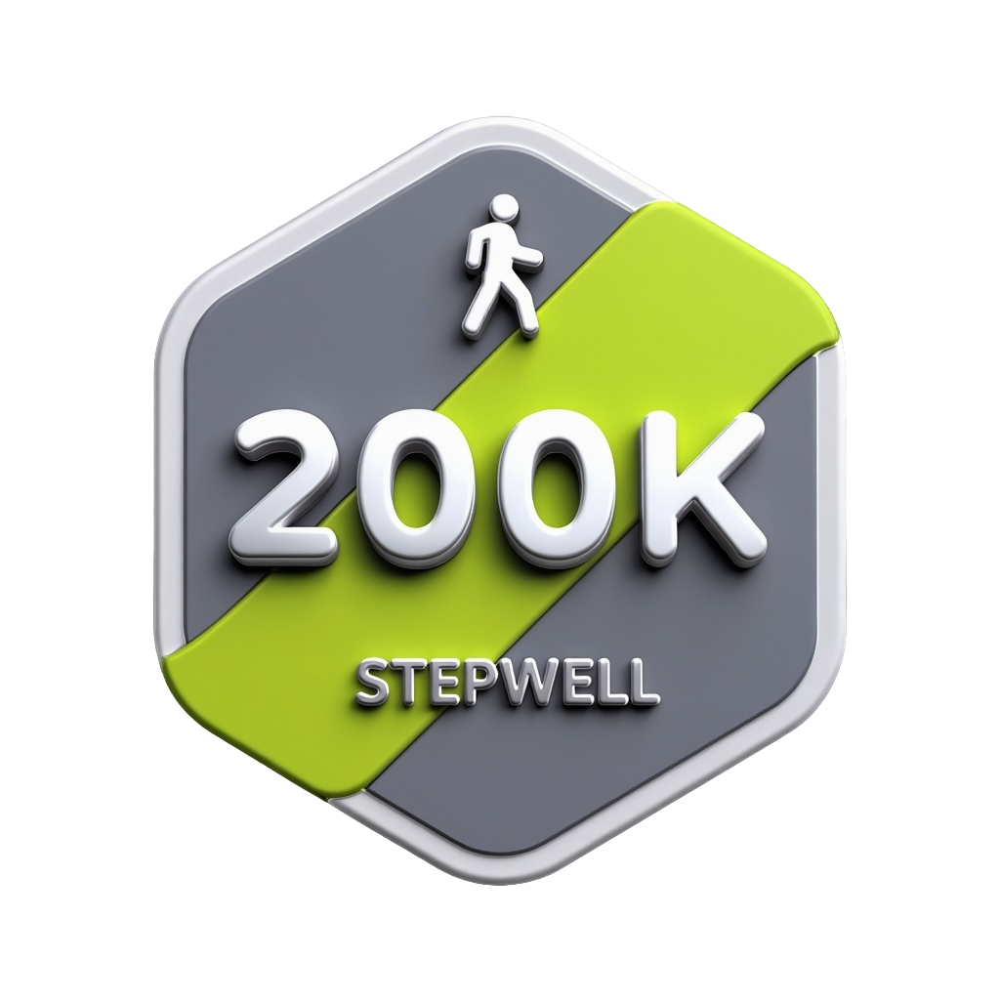
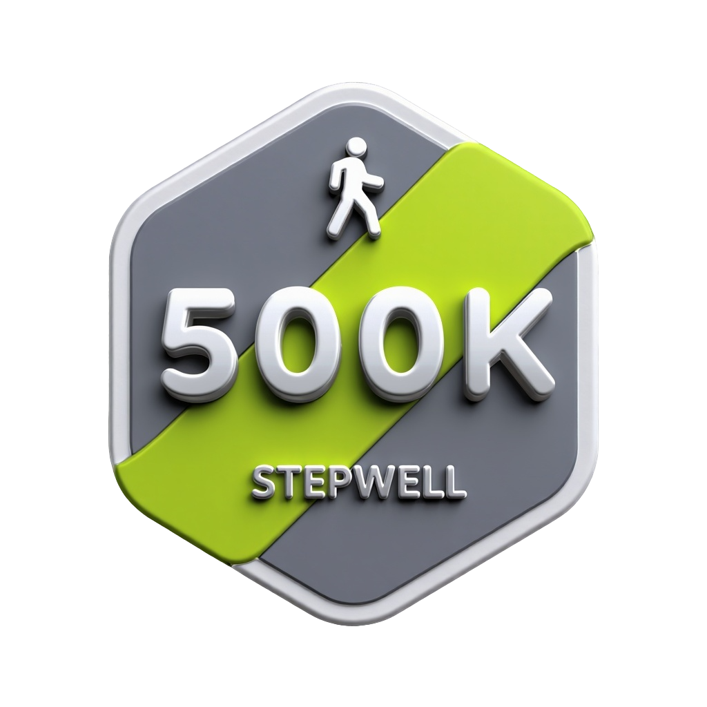

<div align="center">
  
  <h1>StepWell — Cross-Platform Activity & Health Tracking App</h1>
  <p>
    A full-stack mobile and web application for tracking daily physical activity, monitoring health vitals, unlocking 3D milestone achievements, and receiving AI-powered wellness insights.
  </p>
  <p>
    <a href="[https://stepwell-web-beta.vercel.app](https://stepwell-web-beta.vercel.app)"><strong> Live Demo</strong></a> ·
    <a href="#architecture--project-structure"><strong> Architecture</strong></a> ·
    <a href="#api-endpoints"><strong> REST API</strong></a> ·
    <a href="#local-setup"><strong> Local Setup</strong></a>
  </p>
</div>

---

## Overview

**StepWell** bridges daily fitness tracking with personal health monitoring and gamification. Built as a **monorepo**, it delivers a unified experience across **Android, iOS, and Web** from a single Expo / React Native codebase backed by a modular Node.js / Express REST API and a serverless MySQL-compatible cloud database.

> **Note on Live Demo:** The backend API is hosted on Render's free tier and spins down after 15 minutes of inactivity. If authentication or data requests take ~30–50 seconds on the very first visit, the server is waking up from a cold start.

### Key Features
* **Activity & Gamification System:** Tracks daily step progress and rewards consistency with collectible 3D badges across five distance milestones (**10K** to **1M** steps).
* **Role-Based Authentication:** Secure user registration and login supporting both **Patient** and **Doctor** roles using **JWT** authentication and **bcrypt** password hashing.
* **Health Vitals Telemetry:** Tracks and visualizes key physiological metrics (systolic/diastolic blood pressure, blood glucose, $\text{SpO}_2$, and heart rate) with dedicated endpoints for latest snapshots and doctor patient-overviews.
* **AI Wellness Assistant:** Integrated **Google Gemini API** endpoint (`/ai`) providing personalized health and activity recommendations.
* **Live Weather Context:** Fetches real-time weather conditions via the **Open-Meteo API** (`/weather`) to help users plan outdoor walks and runs.
* **Cross-Platform UI:** Adaptive light/dark themes, haptic feedback, and production builds configured for both Web (**Vercel**) and native mobile (**Expo EAS**).

---

## Gamification & 3D Achievements

Users unlock visual 3D milestone badges as their cumulative step count grows:

| 10K Steps | 100K Steps | 200K Steps | 500K Steps | 1M Steps |
| :---: | :---: | :---: | :---: | :---: |
|  |  |  |  |  |
| *First Steps* | *Steady Pace* | *Distance Runner* | *Iron Will* | *StepWell Legend* |

---

## Tech Stack

**Frontend & Mobile (`stepwell_frontend`)**
* **Framework:** React Native, Expo (Expo Router), TypeScript
* **UI / UX:** Custom themed components, responsive Web & Mobile layouts, Haptic Feedback
* **Deployment:** Vercel (Web), Expo Application Services / EAS (Mobile builds)

**Backend (`stepwell_backend`)**
* **Runtime & Framework:** Node.js, Express.js
* **Security:** JSON Web Tokens (`jsonwebtoken`), `bcrypt`, CORS
* **External Integrations:** Google Gemini API, Open-Meteo REST API
* **Deployment:** Render

**Database**
* **Engine:** TiDB Cloud Serverless (MySQL-compatible) over encrypted **TLS 1.2 / SSL** connections (`mysql2/promise`)

---

## Architecture & Project Structure

```text
StepWell/
├── stepwell_frontend/              # Cross-platform client (Expo / React Native / Web)
│   ├── app/                        # File-based routing (Expo Router)
│   │   ├── (tabs)/                 # Main screens: home, explore, login, register
│   │   └── _layout.tsx             # Root layout and navigation stack
│   ├── assets/images/              # App icons and 3D achievement badges
│   ├── components/                 # Reusable UI components
│   ├── hooks/                      # Custom hooks (useHealth, theme color schemes)
│   ├── lib/                        # API client and token/session management
│   └── eas.json                    # Expo EAS build configuration
│
└── stepwell_backend/               # REST API server (Node.js / Express)
    ├── routes/                     # Modular route handlers (ai.js, health.js)
    ├── db.js                       # Shared MySQL/TiDB SSL connection pool
    ├── health.js                   # Service health check module
    ├── server.js                   # Express entry point, auth & metrics endpoints
    └── package.json                # Backend dependencies
